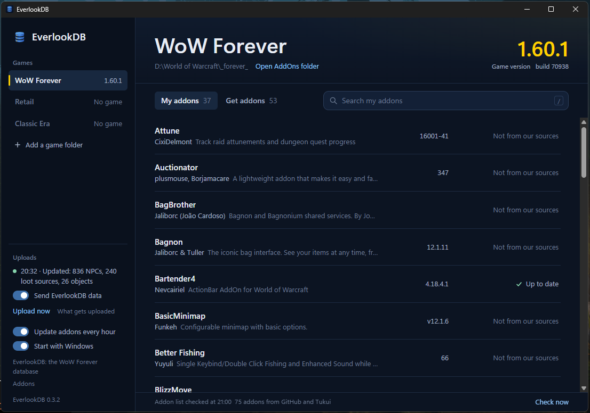

# EverlookDB

A small, ad-free addon manager for World of Warcraft (Windows and macOS), and the uploader for the
[EverlookDB addons](https://github.com/quikmn/EverlookDB)' data to [everlookdb.com](https://everlookdb.com/contribute.html).

- **Finds every game.** Every World of Warcraft folder and every client in it (WoW Forever, Retail, Classic,
  Classic Era, Anniversary, PTR, Beta), with its game version, big and clear. Add a folder by hand if it's
  somewhere unusual.
- **Shows your addons.** Everything in your AddOns folder, grouped (an addon with many folders is one row), with
  its version and whether an update is waiting.
- **Finds new ones.** Instant search over every addon in the EverlookDB catalog (from GitHub releases and Tukui),
  filtered to the game you have selected. Forgiving: typos and spaces still find what you meant. An addon that
  isn't in the list installs from its GitHub link, shown before it installs and then updated like the others.
- **Our addons in one click.** A new install shows the EverlookDB addons, all ticked, with one Install all button.
- **Keeps them updated.** One click to install, update, go back to the previous version or remove. It also checks
  every 10 minutes and updates quietly by itself (you can turn that off); an addon for a game that is running is
  updated the moment the game closes.
- **Never pops up.** The window opens only when you click the tray icon or start the app yourself. The app updates
  itself the same quiet way.
- **Uploads EverlookDB data** for you after you play: see below.

No ads, no account, no tracking. It lives in the tray (Windows) or the menu bar (macOS); click the icon to open the
window.

## Install

Download the latest release from the [releases page](https://github.com/quikmn/everlookdb-uploader/releases):

- **Windows:** the `_x64-setup.exe`. It installs for your user only (no administrator prompt).
- **macOS:** the `_universal.dmg` (Apple silicon and Intel). Drag it to Applications.

If you have the old EverlookDB Uploader, it updates itself into this app and your settings stay.

## What it changes on your PC

- **Addons it installed**, and only those. The previous version is kept so you can go back in one click.
- **Addons you installed another way** (by hand, WowUp, the CurseForge app) are listed and left alone, unless you
  ask EverlookDB to keep one updated. A backup is kept first.
- **The Price Feed** ("EverlookDB Auctions: Price Feed" in the addon list), only when EverlookDB Auctions is
  installed: the app keeps it filled with the latest auction prices other players uploaded. The Price Feed switch
  turns it off.

## Privacy

- **Uploads** send only the game facts the EverlookDB addons saved (`EverlookDB.lua` and `EverlookDBAuctions.lua`),
  after you log out or `/reload`, and only when the file changed. No account or character names, no file paths, no
  other files, nothing about your PC. **Pause uploads** in the tray menu or the switch under Uploads stops it.
- **The addon list and the Price Feed** send nothing about you: only which auction houses to fetch. Addon downloads
  come straight from GitHub or Tukui.
- **Problem reports** are sent only when you click "Report a problem" or "Send error logs". Your user name, account
  folders, emails and keys are taken out first, and "What gets sent" shows the exact text.

More on [everlookdb.com/privacy.html](https://everlookdb.com/privacy.html).

## Tray menu

**Open EverlookDB** (the window), the last upload, **Upload now**, **Open everlookdb.com**, **Change WoW folder…**,
**Start with Windows** / **Open at login**, **Pause uploads** and **Quit**.

## License

GPL-3.0-or-later (see LICENSE). Not affiliated with Blizzard Entertainment.
